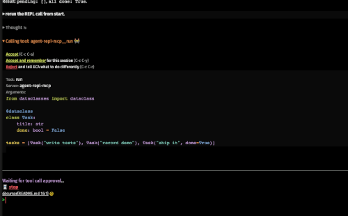

# Agentic Python Tools

A repo containing tools for Agentic Engineering with Python.

[](https://dl.circleci.com/status-badge/redirect/gh/DavidVujic/agentic-python-tools/tree/main)

[](https://codescene.io/projects/87469)

[](https://sonarcloud.io/summary/new_code?id=DavidVujic_agentic-python-tools)

## Agent REPL MCP

__Status__: Work in progress

A Python REPL that agents can use during development.

The REPL MCP gives agents a persistent Python REPL. Each project gets one Jupyter kernel that stays alive across calls, so state like imports and variables carries over. Your agent sends code with `run(data, project_full_path)` and ends the session with `close(project_full_path)`. Edits to real source files are picked up automatically on the next run.

### Installation

``` shell
pip install agent-repl-mcp
```

### Add it to your Agent tool

#### Example: using `uvx`
``` json
{
  "mcpServers": {
    "agent-repl-mcp": {
      "command": "uvx",
      "args": ["agent-repl-mcp"]
    }
  }
}
```

#### Demo

