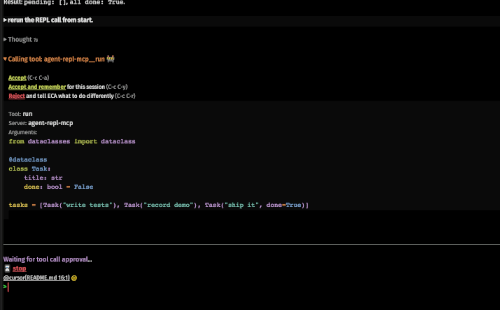

# Agentic Python Tools

A repo containing tools for Agentic Engineering with Python.

[](https://dl.circleci.com/status-badge/redirect/gh/DavidVujic/agentic-python-tools/tree/main)

[](https://codescene.io/projects/87469)

[](https://sonarcloud.io/summary/new_code?id=DavidVujic_agentic-python-tools)

Currently containing two tools:
- Agent REPL MCP
- Agent Checks MCP

## Agent REPL MCP

A Python REPL that agents can use during development.

The REPL MCP gives agents a persistent Python REPL. Each agent session gets its own Jupyter kernel per project that stays alive across calls.  Your agent sends code with `run(data, project_full_path, session_id)` and ends the session with `close(project_full_path, session_id)`. Edits to real source files are picked up automatically on the next run, using the built-in features of the kernel.

Having a persistent REPL will make the __REPL Driven Development__ workflow possible for your agent. The agent can try out and run small portions of code when it need to verify or figure out things, instead of running complex bash calls.

## Setup
The MCP server is built to be used with your harness, and should support all tools that can add MCP Servers.

### Add the MCP server to your harness

Example: using `uvx`:
``` json
{
  "mcpServers": {
    "agent-repl-mcp": {
      "command": "uvx",
      "args": ["agent-repl-mcp"]
    }
  }
}
```

or install it:
``` shell
pip install agent-repl-mcp
```

#### Not using uv?
Nothing else needed, If you have `uv` installed on your system.

Otherwise, your project will need the `ipykernel` package. Add it as a _dev_ dependency:
```toml
[dependency-groups]
dev = [
    "ipykernel",
]
```

### Configure the kernel
Add this to the global IPython configuration (that is also used by Jupyter kernel) to enable auto-reload of changed modules.

``` shell
c.InteractiveShellApp.extensions = ['autoreload']
c.InteractiveShellApp.exec_lines = ['%autoreload 2']
```

How to create and edit [IPython config files](https://ipython.readthedocs.io/en/stable/config/intro.html#python-configuration-files)

## Skills
Copy the [Agent REPL MCP ](./docs/skills/agent-repl-mcp/SKILL.md) skill to your setup and modify it as you like.

## Demo



# Agent Checks MCP

An MCP server that watches a project and serves lint, typecheck, and test results.

The Agent Checks MCP is built to make the code verification process faster and with less frustration. Without human interaction,
it will analyze the codebase to figure out the setup and will find the commands for linting, type checking and testing - without the need of any Agent instructions.

The MCP takes the burden off the Agent. It watches a project in the background and keeps lint, typecheck, and test results up to date,
so your agent gets them instantly instead of having to wait for each run. Each tool takes a `project_full_path` and a `session_id`.

On each file change it will run _lint_ and _type checks_ for the changed code, and the affected _tests_.

Agent Checks MCP has support for the major Python linting and type checking tools, and pytest.

## Setup

### Add the MCP server to your harness

#### Example: using `uvx`
``` json
{
  "mcpServers": {
    "agent-checks-mcp": {
      "command": "uvx",
      "args": ["agent-checks-mcp"]
    }
  }
}
```

or install it:
``` shell
pip install agent-checks-mcp
```

## Figuring out the setup
For each check, it tries these places in order and stops at the first one that has a command:

1. **justfile**: recipe named `lint`, `typecheck`/`type-check`/`types`, or `test`/`tests` (needs `just` installed)
2. **Makefile**: same-named target (needs `make`)
3. **pyproject tasks**: poe, then pixi, then hatch
4. **pyproject tools**: tool listed as a dependency or with a config section/marker file; one command per tool's argv variant, in table order (ruff → flake8 → pylint → black → isort; mypy → ty → pyright; pytest → tox → nox)
5. **venv**: any of those tools actually installed in `.venv`, run as `<venv-python> -m <module>`

This tool is focused on **Python** repos, but if your repo has a Justfile or Makefile with the recipes above, your checks can be run even if they are not Python.

## Skills
Copy the [Agent Checks MCP](./docs/skills/agent-checks-mcp/SKILL.md) skill to your setup and modify it as you like.
